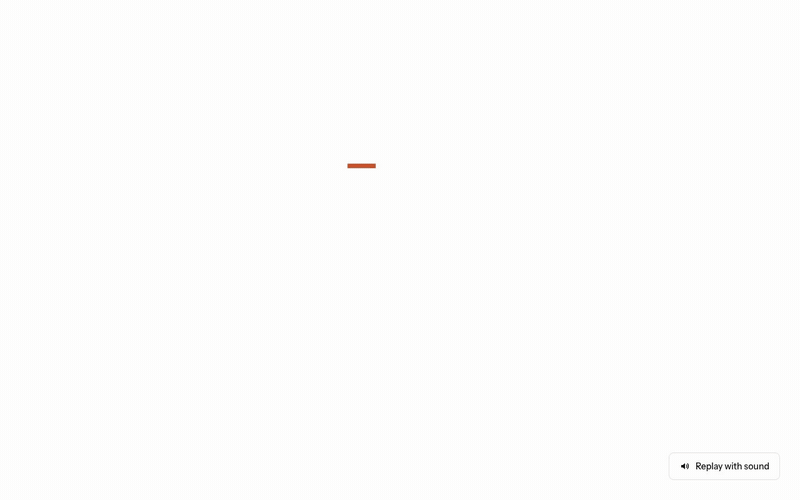
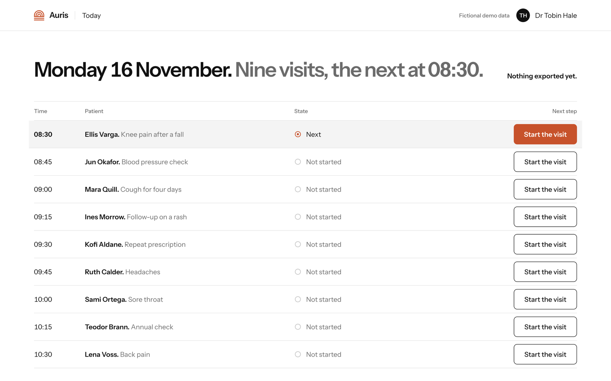
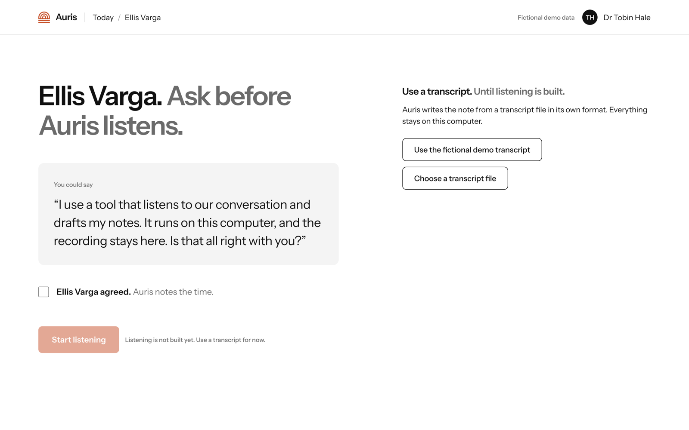
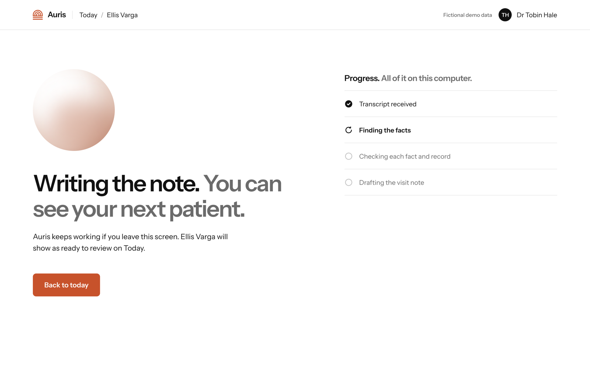
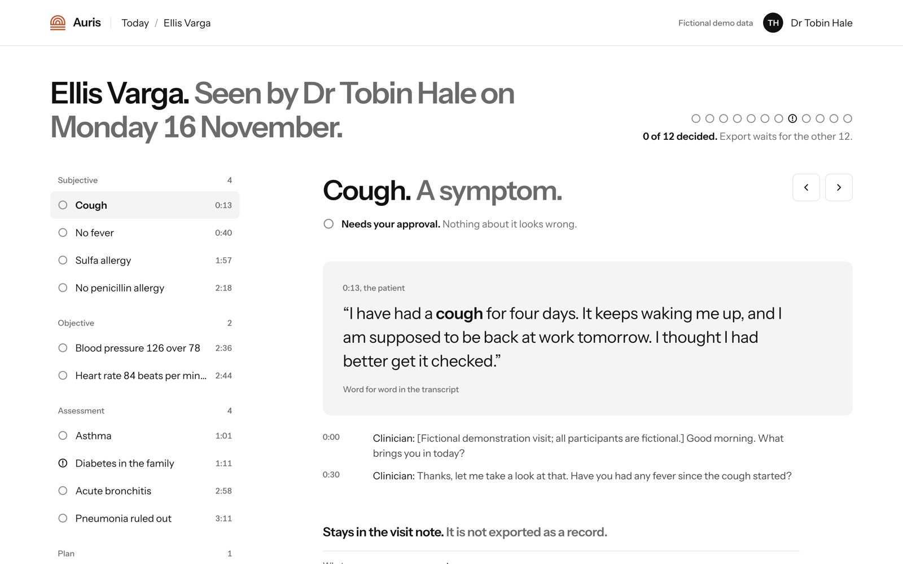
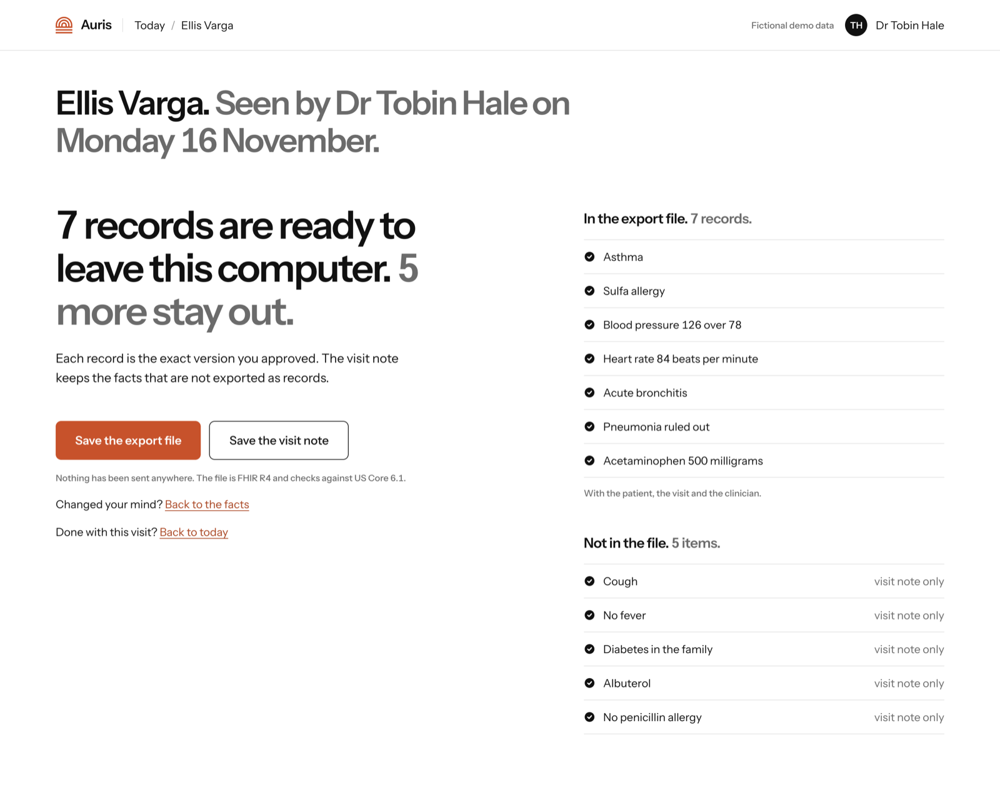

<p align="center">
  <picture>
    <source media="(prefers-color-scheme: dark)" srcset="docs/brand/auris-mark-dark.svg">
    
  </picture>
</p>

<h1 align="center">Auris</h1>

<p align="center">
  <strong>An open-source clinical scribe that runs on your own computer.</strong><br>
  It listens to a doctor–patient visit, drafts the note, and lets the clinician decide what becomes part of the record.
</p>

<p align="center">
  <a href="LICENSE"></a>
  
  
  
</p>

<p align="center">
  <br>
  <sub>A fictional visit from the day's schedule to the FHIR export, sped up.
  <a href="docs/media/walkthrough.mp4">Watch it in full quality (MP4)</a>.</sub>
</p>

> [!IMPORTANT]
> Auris is early research software. It is **not a medical device** and is not
> approved for clinical use. A clinician must review everything it produces.
> All patients, visits and transcripts in this repository are fictional.

## Why Auris?

AI scribes save clinicians hours of typing, but many of them send the
conversation to a cloud service and hand back a finished note that is hard to
check. Auris takes a different approach:

- **Private by design.** Speech recognition, the language model and every
  check run locally. Nothing leaves the computer unless you export it.
- **Every fact shows its source.** Each item in the note links to the exact
  words in the transcript, with the time and the speaker.
- **Nothing is invented.** If a dose or a frequency was not said, the field
  stays empty and is flagged. The model never writes medical codes.
- **The clinician decides.** Nothing becomes a record until a person approves
  it, and every approval is logged.
- **Standard output.** Approved items are exported as
  [FHIR R4](https://hl7.org/fhir/R4/) records, the format hospital systems use
  to exchange data, checked against the
  [US Core](https://hl7.org/fhir/us/core/STU6.1/) profiles with the official
  HL7 validator.

## Features

- Speech to text with speaker separation, using
  [Whisper](https://github.com/openai/whisper) locally
- Extraction of symptoms, conditions, vital signs, medicines and allergies,
  using a local model through
  [llama.cpp](https://github.com/ggml-org/llama.cpp)
- Automatic checks on every fact: the quote must match the transcript word
  for word, a nearby "no" or "not" cannot be dropped from a quote, and numbers
  must actually have been said
- A visit note in the familiar SOAP layout (Subjective, Objective,
  Assessment, Plan)
- Medical coding with RxNorm (medicines) and ICD-10-CM (conditions), done by
  lookup rather than by the model
- A desktop app for the clinic day: schedule, consent prompt, background note
  writing, review and export
- A browser review page and a command-line tool for working with individual
  visits

## A walk through a visit

**See the day.** Each visit shows what it needs next.



**Ask before listening.** Auris suggests what to say to get the patient's
consent and records the time it was given.



**Let it write.** The note is drafted in the background while you see the next
patient.



**Review.** Approve, correct or dismiss each fact, with its quote and the
surrounding conversation in view.



**Export.** Approved records are saved as a FHIR file, together with the visit
note. Items that should not become records, such as a symptom or a denied
allergy, stay in the note.



## From conversation to FHIR R4

Here is part of the fictional demo visit and what Auris exported from it after
the clinician approved each fact.

> **Patient** (1:57): I am allergic to sulfa; it gave me a rash years ago. I
> cannot remember the name on the bottle, but I remember the rash.
>
> **Clinician** (2:36): Your blood pressure is 126 over 78. You can relax your arm now.
>
> **Clinician** (3:39): Start acetaminophen 500 milligrams by mouth every eight
> hours as needed. Let me write that down so you have the instructions at home.

| What was said | FHIR R4 resource | What it contains |
|---|---|---|
| "allergic to sulfa; it gave me a rash" | `AllergyIntolerance` (US Core) | the substance as spoken ("sulfa"), the reaction ("rash"), marked *unconfirmed* until a clinician confirms it |
| "blood pressure is 126 over 78" | `Observation` (US Core Blood Pressure) | LOINC 85354-9, with systolic 126 mm[Hg] and diastolic 78 mm[Hg] as separate components |
| "Start acetaminophen 500 milligrams…" | `MedicationRequest` (US Core) | RxNorm 161 (acetaminophen), the dosage exactly as said, and status *draft*: Auris never signs or sends an order |

The export is a FHIR `Bundle` of type `collection`. For this visit it holds
3 `Condition`, 2 `Observation`, 1 `AllergyIntolerance` and 1 `MedicationRequest`
resources, plus the `Patient`, `Practitioner` and `Encounter` they refer to.
Things that are not records, such as symptoms, denials and family history, stay
in the visit note.

<details>
<summary><b>Observation</b>: blood pressure 126/78</summary>

```json
{
  "category": [
    {
      "coding": [
        {
          "code": "vital-signs",
          "system": "http://terminology.hl7.org/CodeSystem/observation-category"
        }
      ]
    }
  ],
  "code": {
    "coding": [
      {
        "code": "85354-9",
        "system": "http://loinc.org"
      }
    ]
  },
  "component": [
    {
      "code": {
        "coding": [
          {
            "code": "8480-6",
            "system": "http://loinc.org"
          }
        ]
      },
      "valueQuantity": {
        "code": "mm[Hg]",
        "system": "http://unitsofmeasure.org",
        "unit": "mmHg",
        "value": 126
      }
    },
    {
      "code": {
        "coding": [
          {
            "code": "8462-4",
            "system": "http://loinc.org"
          }
        ]
      },
      "valueQuantity": {
        "code": "mm[Hg]",
        "system": "http://unitsofmeasure.org",
        "unit": "mmHg",
        "value": 78
      }
    }
  ],
  "effectiveDateTime": "2026-11-16T08:30:00-05:00",
  "encounter": {
    "reference": "urn:uuid:19b3e431-c0c9-5985-82e8-7e63847e12f8"
  },
  "id": "805b73c6-5cc6-5706-85c9-ddd3931c31c4",
  "meta": {
    "profile": [
      "http://hl7.org/fhir/us/core/StructureDefinition/us-core-blood-pressure"
    ]
  },
  "resourceType": "Observation",
  "status": "preliminary",
  "subject": {
    "reference": "urn:uuid:7f7cae25-8a11-5e8b-9c64-304be9a70b46"
  }
}
```

</details>

<details>
<summary><b>AllergyIntolerance</b>: sulfa, reaction rash</summary>

```json
{
  "clinicalStatus": {
    "coding": [
      {
        "code": "active",
        "system": "http://terminology.hl7.org/CodeSystem/allergyintolerance-clinical"
      }
    ]
  },
  "code": {
    "text": "sulfa"
  },
  "encounter": {
    "reference": "urn:uuid:19b3e431-c0c9-5985-82e8-7e63847e12f8"
  },
  "id": "88d69937-7b0f-5561-812b-004f45adf7a3",
  "meta": {
    "profile": [
      "http://hl7.org/fhir/us/core/StructureDefinition/us-core-allergyintolerance"
    ]
  },
  "patient": {
    "reference": "urn:uuid:7f7cae25-8a11-5e8b-9c64-304be9a70b46"
  },
  "reaction": [
    {
      "manifestation": [
        {
          "text": "rash"
        }
      ]
    }
  ],
  "resourceType": "AllergyIntolerance",
  "verificationStatus": {
    "coding": [
      {
        "code": "unconfirmed",
        "system": "http://terminology.hl7.org/CodeSystem/allergyintolerance-verification"
      }
    ]
  }
}
```

</details>

<details>
<summary><b>MedicationRequest</b>: acetaminophen 500 mg, draft</summary>

```json
{
  "authoredOn": "2026-11-16T08:30:00-05:00",
  "dosageInstruction": [
    {
      "text": "500 milligrams by mouth every eight hours as needed"
    }
  ],
  "encounter": {
    "reference": "urn:uuid:19b3e431-c0c9-5985-82e8-7e63847e12f8"
  },
  "id": "5a7a6415-e0d0-5373-8f89-82042562f681",
  "intent": "proposal",
  "medicationCodeableConcept": {
    "coding": [
      {
        "code": "161",
        "display": "acetaminophen",
        "system": "http://www.nlm.nih.gov/research/umls/rxnorm"
      }
    ],
    "text": "acetaminophen"
  },
  "meta": {
    "profile": [
      "http://hl7.org/fhir/us/core/StructureDefinition/us-core-medicationrequest"
    ]
  },
  "reportedBoolean": false,
  "requester": {
    "reference": "urn:uuid:192f4b09-66eb-5d03-a351-dd8286a7164d"
  },
  "resourceType": "MedicationRequest",
  "status": "draft",
  "subject": {
    "reference": "urn:uuid:7f7cae25-8a11-5e8b-9c64-304be9a70b46"
  }
}
```

</details>

## Quick start

Requirements: macOS or Linux, [mise](https://mise.jdx.dev), `llama-server`
from [llama.cpp](https://github.com/ggml-org/llama.cpp) on your `PATH`, and
about 10 GB of free disk space.

```sh
git clone https://github.com/supermax01/auris.git
cd auris
mise install                              # Python 3.12, uv and Java 21
uv sync
uv run auris setup fhir                   # FHIR packages
uv run auris setup terminology --fetch    # RxNorm and ICD-10-CM
uv run auris setup validator --fetch      # the official HL7 validator
uv run auris setup model --fetch          # the local language model (about 5 GB)
uv run auris demo                         # a fictional visit, written to ./out/demo
```

Setup is the only step that downloads anything. Every download is checked
against a pinned checksum.

## Usage

### Desktop app

The desktop app needs [Node.js](https://nodejs.org) 22 or later and
[Rust](https://www.rust-lang.org/tools/install). To try it with a fictional
clinic day:

```sh
npm --prefix ui ci
npm --prefix desktop ci
cd desktop && AURIS_DEMO=1 npm run dev
```

Pick a visit, choose **Start the visit**, then **Use the fictional demo
transcript**.

Without Rust, you can run the same interface in your browser:

```sh
npm --prefix ui ci && npm --prefix ui run build
uv run auris app serve --demo --data ~/auris-demo
```

Then open the `http://127.0.0.1:…` address it prints. Keep that address
private: it contains the session key.

### Command line

Write a note from a transcript and visit details (see [`examples/`](examples/)
for the file formats):

```sh
uv run auris run --transcript examples/transcript.json \
  --intake examples/intake.json --out out/visit
```

Review the result in your browser:

```sh
uv run auris review serve --run out/visit
```

Turn a recording into a transcript (one room microphone, or one file per
speaker):

```sh
uv sync --extra speech
uv run auris setup asr --fetch
uv run auris transcribe --audio visit.wav --out out/visit/transcript.json
```

Each run writes `note.md` (the visit note), `bundle.json` (the FHIR records),
`extraction.json` and `validation.json` into its own private folder.

| Command | Description |
|---|---|
| `auris setup <part>` | Download and verify a component: `fhir`, `terminology`, `validator`, `model`, `asr` |
| `auris demo` | Run the fictional demo visit |
| `auris run` | Write the note and records for one visit |
| `auris transcribe` | Turn audio into a transcript |
| `auris review serve` | Review a visit in the browser |
| `auris app serve` | Start the engine behind the desktop app |
| `auris fhir-check` | Load an export into a local FHIR test server and check it |

## How it works

```
recording ─► transcript ─► facts ─► checks ─► FHIR records ─► clinician review ─► export
            (Whisper)     (local    (quotes,   (US Core,       (approve, correct,   (FHIR file
                           model)    numbers,   validated       or dismiss)          + note)
                                     speakers)  offline)
```

1. **Transcript.** Whisper turns the audio into text with timestamps, and
   each speaker is identified as clinician or patient.
2. **Facts.** A local model reads the transcript and fills in a fixed form for
   each fact, quoting the words it relied on.
3. **Checks.** Each quote is matched against the transcript. Facts with
   unsupported numbers, the wrong speaker or a missing negation are flagged or
   refused.
4. **Records.** Facts are converted to FHIR resources, coded from the
   terminology files, and validated with the official HL7 validator.
5. **Review.** The clinician approves, corrects or dismisses each fact. Only
   approved records can be exported.

## Project status

Auris is pre-alpha. Today it can:

- write a note and FHIR records from a transcript or a recording
- show every fact with its source for review, in the desktop app or a browser
- export approved records and the note

Not yet available:

- live listening in the desktop app (it works from transcript files for now)
- a packaged, signed desktop app (it runs from source)
- sign-in and multi-user support

## Repository layout

| Path | Contents |
|---|---|
| `src/auris/` | The Python engine: speech, extraction, checks, FHIR mapping, review |
| `ui/` | The app interface (React) |
| `desktop/` | The desktop window (Tauri) |
| `config/` | Pinned versions and checksums of every model, package and terminology file |
| `examples/` | A fictional transcript and visit details |
| `docs/` | FHIR notes, the US Core profile checklist and the brand assets |
| `tests/` | The test suite (all data fictional) |

## Development

```sh
uv run pytest                  # tests that need models or the validator skip until setup
uv run ruff check src tests
uv run ruff format --check src tests
```

Issues and pull requests are welcome. Please keep all test data fictional.

## Privacy

Auris has no telemetry and makes no outside network connections after
setup; its parts talk to each other only on your own computer. Visit
data is stored in a private folder on your computer, readable only by your
user account.

## License

Auris is released under the [Apache License 2.0](LICENSE).

It builds on [Whisper](https://github.com/openai/whisper),
[Qwen3](https://huggingface.co/Qwen/Qwen3-8B-GGUF),
[llama.cpp](https://github.com/ggml-org/llama.cpp),
[SpeechBrain](https://speechbrain.github.io),
[HL7 FHIR](https://hl7.org/fhir/) and [Tauri](https://tauri.app). RxNorm,
ICD-10-CM, LOINC and UCUM content is used under the terms listed in
[NOTICE](NOTICE). Terminology files, FHIR packages and model weights are
downloaded from their publishers at setup and are not included in this
repository.
