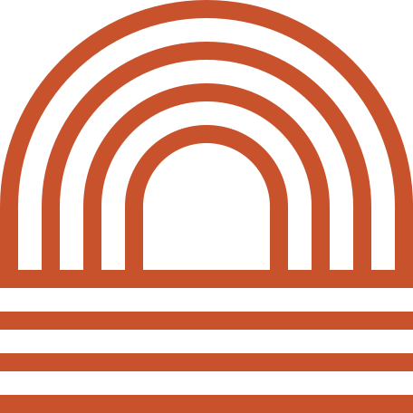
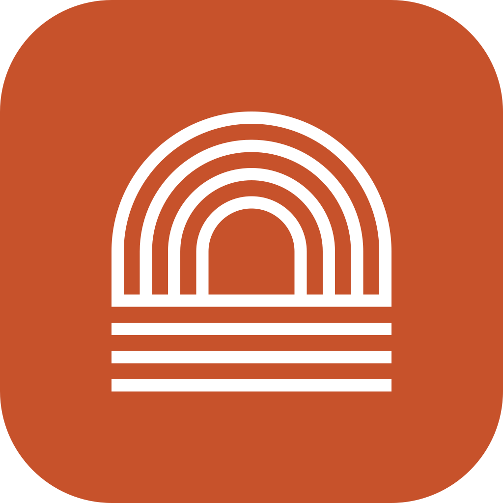
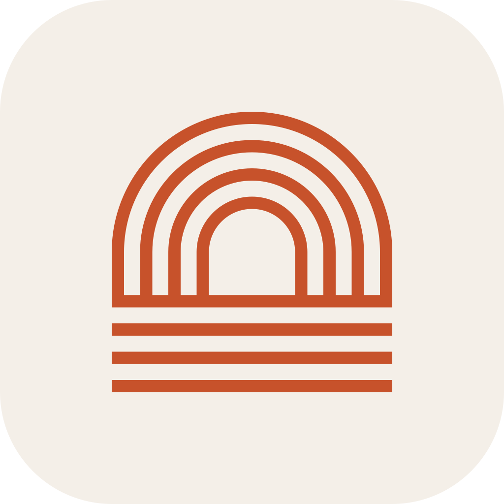

# Auris brand assets · Version 3 — arches and lines

<p>
  
  &nbsp;&nbsp;
  
  &nbsp;&nbsp;
  
</p>

Auris listens to a recorded doctor–patient visit and writes a structured
record and a visit note, with every fact tied to the words that were said.
The mark says exactly that: **spoken sound** (the arches) settling into **the
written note** (the lines). Do not add medical crosses, hearts, stethoscopes
or caduceus imagery.

The concept was generated with Midjourney 8.2 (raw mode, stylise 50) from
this prompt, chosen on 2026-11-13, and then redrawn on an exact
grid:

> Minimal flat logo symbol: three concentric sound arcs that straighten into
> three horizontal lines of writing, spoken words becoming a written record.
> Geometric, balanced, one flat color on white, app icon simplicity, Swiss
> modernist identity

Every file here is generated by [`tools/build_brand.py`](tools/build_brand.py)
(standard library only, offline, deterministic). Do not edit the SVGs or PNGs
by hand; change the geometry or colours in the script and rebuild.

```sh
python3 docs/brand/tools/build_brand.py           # write all assets
python3 docs/brand/tools/build_brand.py --check   # verify they are current
```

## Construction

One rule set builds every size. With stroke `s`, gap `g`, opening radius `a`
and `n` arches over `n` lines:

- outer radius `R = a + n·s + (n−1)·g`, and the mark is exactly `2R` square;
- each arch's straight legs are `a` long, so the opening is a half circle on a
  block of the same height, and the arches stand on the first line;
- lines run the full width; the pitch of the lines equals the pitch of the
  arches.

| Version | File | Grid | `s` / `g` / `a` / `n` | Use at |
| --- | --- | --- | --- | --- |
| Full | `auris-mark.svg` | 456 | 20 / 26 / 70 / 4 | 64 px and larger |
| Medium | `auris-mark-medium.svg` | 24 | 2 / 2 / 2 / 3 | 24 and 48 px |
| Small | `auris-mark-small.svg` | 16 | 2 / 2 / 2 / 2 | 16 and 32 px (favicon) |

The medium and small versions are optical reductions: four arches turn to
mush below about 48 px, so they drop arches and snap every edge to whole
pixels at their sizes. They are the same idea, not a different logo.

Clear space: keep at least the opening radius (`a`; about 15% of the mark's
width) free on every side.

## Colour

| Role | Hex | Use | Contrast |
| --- | --- | --- | --- |
| Terracotta | `#C7522B` | Mark on light surfaces; app icon tile | 4.50:1 on white, 3.93:1 on paper |
| Light terracotta | `#E58A62` | Mark on dark surfaces | 7.21:1 on `#17120F` |
| Paper | `#F4EFE8` | Light app icon tile | — |
| White | `#FFFFFF` | Mark on the terracotta tile | 4.50:1 on terracotta |
| Black / white | `#000000` / `#FFFFFF` | Single-colour printing | — |

Terracotta is the logo's colour only. In the product UI, orange-red would
read as a warning, so status colours (warning, error) stay clearly distinct
from it, and the brand colour is never used to signal a state.

## Files

| File | What |
| --- | --- |
| `auris-mark.svg`, `auris-mark-dark.svg` | Full mark, light and dark surfaces |
| `auris-mark-medium(-dark).svg`, `auris-mark-small(-dark).svg` | Optical small-size versions |
| `auris-mark-mono-black.svg`, `auris-mark-mono-white.svg` | Single colour |
| `auris-app-icon.svg` | White mark on a rounded terracotta tile |
| `auris-app-icon-light.svg` | Terracotta mark on a rounded paper tile |
| `auris-app-icon-fullbleed.svg` | Square tile for platforms that apply their own mask |
| `png/auris-mark-1024.png`, `png/auris-mark-dark-1024.png` | Raster mark, transparent |
| `png/auris-app-icon*-1024.png` | Raster app icons |
| `png/favicon-16.png`, `-32`, `-48` | Browser icons (small, small, medium) |
| `png/favicon-180.png` | Apple touch icon (opaque; the platform rounds it) |
| `png/favicon-512.png` | Rounded app icon at 512 px |

All SVGs are filled paths (no strokes), with a `<title>` for accessibility.

## Wordmark

Not drawn yet. It follows the product typeface chosen in the UI redesign.
Until then, set "Auris" in the UI type next to the mark.
